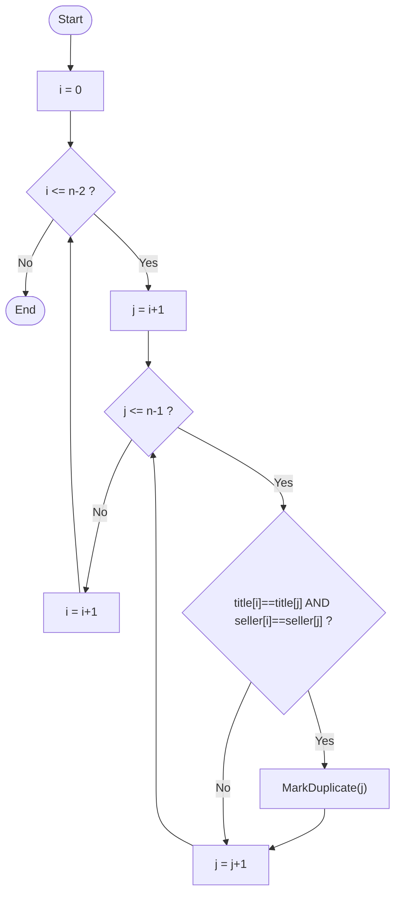
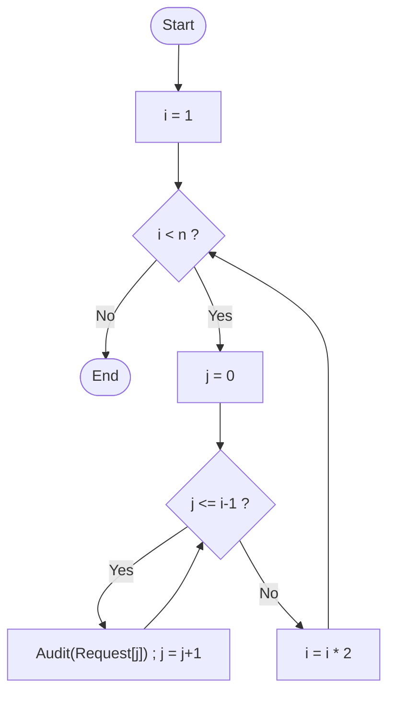
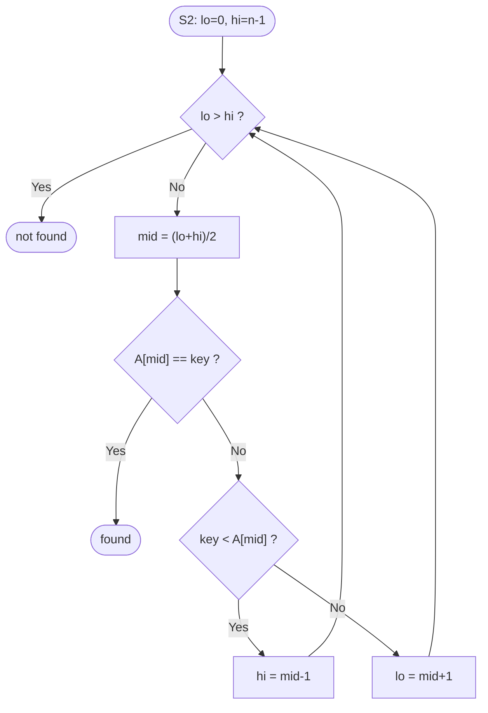

# CSA06 – Design and Analysis of Algorithms
## CO1 – Assessment Tool 1: Scalability Audit of an E-Commerce Platform ("ShopSphere")

| | |
|---|---|
| **Student Reg. No. / Name** | *(fill in)* |
| **Title** | Analytical Problem Solving – Scalability Audit of ShopSphere |
| **Objective** | Determine algorithm efficiency using asymptotic notation, substitution, iteration, recursion trees and the Master Theorem; decide which back-end modules must be redesigned before n grows from 100,000 to 1,000,000 products. |
| **Software Used** | Python 3.12.3 |
| **Tools** | Terminal / VS Code, `matplotlib` (plots) |
| **Algorithms / techniques** | Nested-loop counting, doubling-loop summation, backward substitution, Master Theorem (+ extended case), recursion tree, formal Θ proof, best/average/worst-case analysis |
| **Result** | M1 = n(n−1)/2 = Θ(n²); M2 = 2^⌈log₂n⌉ − 1 = Θ(n) (the Θ(n log n) claim is **wrong**); S2 = ⌊log₂n⌋+1 = Θ(log n); M4 current Θ(n²) → redesign Θ(n log n); M5 Θ(n log²n); report generator Θ(n²) and not O(n). At n = 10⁶ the M4 current design (33 min) and the report generator (50 min) miss the 10-minute window; M1 (8.3 min) passes only narrowly and breaks at ≈ 1.1 M products. |

> **Assumption about server speed.** The question paper text reads "execute 10 basic operations per second"; the superscript was lost in the PDF, so I have taken it as **10⁹ operations/second**. Every time is also given at 10⁸ ops/s for sensitivity. If your paper's exponent differs, change `OPS_PER_SEC` in `src/experiment.py` and recompute time = operations ÷ speed; all *operation counts* are independent of this assumption.

## Folder structure

```
CSA06_CO1_ShopSphere_Audit/
├── README.md
├── src/modules.py        <- M1-M5, S1/S2 implementations with operation counters + closed forms
├── src/experiment.py     <- verification, timing, projection, plots
├── tests/test_modules.py <- tests (counts, closed forms, bounds)
├── results/              <- CSV / JSON / console output
└── plots/                <- growth_curves, m2_sawtooth, m1_timing, projection_1M
```
Run: `pip install matplotlib && python tests/test_modules.py && python src/experiment.py`

## Aim
To audit five back-end modules of ShopSphere, derive their exact operation counts and asymptotic complexity, validate the derivations by running code that counts the basic operation, and recommend which modules to redesign for n = 1,000,000.

## Objective
(a) identify input size and basic operation; (b) analyse the iterative modules M1, M2; (c) solve S2's recurrence by substitution; (d) apply the Master Theorem to M4 and M5; (e) best/average/worst cases of S1, S2; (f) prove f(n) = Θ(n²); (g) estimate running times and decide on redesigns.

---

# (a) Understand the problem – input size and basic operation

| Module | Input size n | Basic operation | Where it occurs | Expected growth of its count |
|---|---|---|---|---|
| **M1** duplicate detector | number of products | comparison `Product[i].title = Product[j].title` (the seller comparison runs only when titles match, so it cannot exceed the title comparisons) | innermost loop body | executes once for every pair (i<j): grows **quadratically** – doubling n quadruples the work |
| **M2** API rate limiter | number of requests n (window limit) | `Audit(Request[j])` (given) | inner `FOR` loop | the inner loop length doubles every outer round (1, 2, 4, …) – a **geometric** series, so the total is dominated by the last round, i.e. **linear** in n |
| **M3** search S1 / S2 | number of products / index entries | key comparison with a catalogue entry (S1) / with the middle entry (S2) | each loop iteration (S1) / each halving (S2) | S1: up to **n**; S2: one comparison per halving, so **log₂ n** |
| **M4** recommendation engine | size of the customer–product data | the combine/merge step – one unit of work per element merged (the "+ n" term), executed at every node of the recursion tree | after the recursive calls | the *number of nodes* decides growth: 4 calls of size n/2 give 4ᵏ nodes at depth k (→ **n²** leaf work) while 2 calls give only 2ᵏ (→ **n log n**) |
| **M5** sales analytics | number of sales records | the comparison made while sorting a sub-array of size m (m log m of them) at every recursion node | the "sort at every level" step | each level costs ≈ n(log n − i), summed over log n levels → about **n log² n / 2** |

*Report generator:* input n, basic operation = one of the profiled operations; dominated by the 3n² term.

---

# (b) Iterative modules

## M1 – exact number of comparisons
For i = 0 … n−2, the inner loop runs j = i+1 … n−1, i.e. (n−1−i) times:

C(n) = Σ_{i=0}^{n−2} (n−1−i) = (n−1) + (n−2) + … + 2 + 1 = **n(n−1)/2** = (n² − n)/2.

It does not depend on the data (every pair is always compared) – best = average = worst.
* n = 100,000: 4,999,950,000 comparisons
* n = 1,000,000: **499,999,500,000 ≈ 5×10¹¹**

**Time complexity:** (n² − n)/2 ≤ n² and ≥ n²/4 for n ≥ 2 ⇒ **Θ(n²)**.
**Space complexity:** only the loop counters i, j are needed: **Θ(1) auxiliary space** (the input array itself takes Θ(n)).
*Implementation check:* `m1_bruteforce` counted exactly n(n−1)/2 for every tested n (`results/verification.csv`).



## M2 – exact number of Audit operations
Outer loop: i takes the values 1, 2, 4, …, 2^(k−1) while i < n; the loop stops at the first i = 2^k ≥ n. So the number of outer iterations is **k = ⌈log₂ n⌉**.
In the round where i = 2^t the inner loop runs j = 0 … i−1, i.e. **i = 2^t** times (not n times!).

A(n) = Σ_{t=0}^{k−1} 2^t = 2^k − 1, where k = ⌈log₂ n⌉  ⇒ **A(n) = 2^⌈log₂ n⌉ − 1**.

**Is Θ(n log n) correct? No.** The team member bounded every inner loop by n, giving the loose upper bound k·n. In reality the inner loops are 1, 2, 4, …, and their sum is dominated by the last term. Since k = ⌈log₂ n⌉ ⇒ n ≤ 2^k < 2n:

n − 1 ≤ A(n) = 2^k − 1 < 2n − 1, so  **n − 1 ≤ A(n) ≤ 2n − 2**

Hence A(n) = Ω(n) and O(n): the tight bound is **Θ(n)**. (Θ(n log n) is false because n log n ≠ O(n); "O(n log n)" is a true but not tight upper bound.)
Time Θ(n); space Θ(1).

**Verification for n = 1,024 (= 2¹⁰):** i takes 1, 2, 4, …, 512 (i = 1024 is not < 1024) → k = 10 rounds.
A = 1 + 2 + 4 + 8 + 16 + 32 + 64 + 128 + 256 + 512 = **1,023 = 2¹⁰ − 1** (and n − 1 = 1,023 ✓). The claimed n log₂ n = 10,240, i.e. **10× too large**. The program gives exactly (1023 ops, 10 iterations); for n = 1025 it gives 2047 (the upper end, 2n−2 = 2048 → 2047), showing the count jumps when n passes a power of two (`plots/m2_sawtooth.png`).

| n | Audit ops (measured = formula) | claimed n log₂ n |
|---|---|---|
| 1,024 | 1,023 | 10,240 |
| 100,000 | 131,071 | 1,660,964 |
| 1,000,000 | 1,048,575 | 19,931,569 |




---

# (c) Solve S2's recurrence by backward substitution

T(n) = T(n/2) + 1, T(1) = 1. (The method is applicable because each step reduces n by a constant factor with constant extra work; take n = 2^k.)

```text
T(n)  = T(n/2) + 1
      = [T(n/4) + 1] + 1          = T(n/4) + 2
      = [T(n/8) + 1] + 2          = T(n/8) + 3
      …
      = T(n/2^i) + i              (pattern after i substitutions)
```
The recursion stops when n/2^i = 1 ⇒ i = log₂ n, and T(1) = 1:

**T(n) = T(1) + log₂ n = log₂ n + 1** for n = 2^k.
For general n: **T(n) = ⌊log₂ n⌋ + 1** (proved by induction using ⌊log₂⌊n/2⌋⌋ = ⌊log₂ n⌋ − 1).
Check: n = 1,000,000 → ⌊19.93⌋ + 1 = **20** comparisons; measured maximum = 20.

| Implementation | Time | Space |
|---|---|---|
| Iterative (loop with lo, hi) | Θ(log n) | **Θ(1)** |
| Recursive | Θ(log n) | **Θ(log n)** – call stack of ⌊log₂ n⌋ + 1 frames (20 frames for 10⁶), since each call waits for its child |



---

# (d) Master Theorem

For T(n) = aT(n/b) + f(n), compare f(n) with n^(log_b a).
Case 1: f = O(n^(log_b a − ε)) ⇒ Θ(n^(log_b a)); Case 2: f = Θ(n^(log_b a) log^k n), k = 0 ⇒ Θ(n^(log_b a) log n); Case 3: f = Ω(n^(log_b a + ε)) and regularity ⇒ Θ(f).

## M4 – current design: T(n) = 4T(n/2) + n
a = 4, b = 2, f(n) = n, n^(log_b a) = n^(log₂ 4) = **n²**.
f(n) = n = O(n^(2−ε)) with ε = 1 ⇒ **Case 1** ⇒ **T(n) = Θ(n²)**.
(Exact, by recursion tree: level i has 4^i nodes costing n/2^i each = n·2^i; summing i = 0…log n − 1 gives n(n − 1); the n² leaves add n²; so **T(n) = 2n² − n**, matching the program.)

## M4 – proposed redesign: T(n) = 2T(n/2) + n
a = 2, b = 2, f(n) = n, n^(log₂ 2) = **n**. f(n) = Θ(n) = Θ(n^(log_b a) · log⁰ n) ⇒ **Case 2** ⇒ **T(n) = Θ(n log n)**.
(Exact: log₂ n levels × n + n leaves ⇒ **T(n) = n log₂ n + n**.)

| | Current | Redesign |
|---|---|---|
| a, b, f(n), n^(log_b a), case | 4, 2, n, n², Case 1 | 2, 2, n, n, Case 2 |
| Complexity | Θ(n²) | Θ(n log n) |
| Ops at n = 10⁶ | 2×10¹² | 2.09×10⁷ |
| Effect of doubling the data | T(2n)/T(n) = (8n²−2n)/(2n²−n) → **4×** | T(2n)/T(n) = 2(log₂n + 2)/(log₂n + 1) ≈ **2.1×** (2.10 at 10⁶) |

Doubling the catalogue from 10⁶ to 2×10⁶ would take the current design from 33 min to ≈ 2.2 h (4×); the redesign goes from 0.021 s to ≈ 0.044 s. Removing the replication changes the number of recursive calls from 4 to 2, which is what moves the work from n² to n log n.

## M5: T(n) = 2T(n/2) + n log n
a = 2, b = 2 ⇒ n^(log_b a) = n.
* Case 1 needs f = O(n^(1−ε)): n log n is larger than n ⇒ no.
* Case 2 (basic form) needs f = Θ(n): n log n ≠ Θ(n) ⇒ no.
* Case 3 needs f = Ω(n^(1+ε)) for some ε > 0: n log n = o(n^(1+ε)) for every ε > 0 ⇒ no.

**None of the three standard cases applies** – f is larger than n only by a logarithmic factor (the "gap" between cases 2 and 3).

*Extended Master Theorem:* if f(n) = Θ(n^(log_b a) log^k n) with k ≥ 0, then T(n) = Θ(n^(log_b a) log^(k+1) n). Here k = 1 ⇒ **T(n) = Θ(n log² n)**.

*Recursion-tree verification (n = 2^L, L = log₂ n):* at depth i there are 2^i nodes, each of size n/2^i, each costing (n/2^i)·log₂(n/2^i) ⇒ level cost n(L − i).
Σ_{i=0}^{L−1} n(L − i) = n(L + (L−1) + … + 1) = n·L(L+1)/2; leaves add n·T(1) = n.

**T(n) = n·L(L+1)/2 + n = ½ n log²n + ½ n log n + n = Θ(n log² n).**
(Program: m5_recurrence = closed form for n = 2^k, k ≤ 14.) At n = 10⁶: 2.096×10⁸ operations.
Meaning: sorting at every level wastes a log factor: merging the already-sorted halves (ordinary merge sort, T = 2T(n/2) + n) would give Θ(n log n).

---

# (e) Best, average and worst cases

## S1 – sequential scan (unsorted)
* **Best:** product is the first element – **1** comparison.
* **Worst:** product is last or absent – **n** comparisons (everything must be ruled out).
* **Average (successful):** position i equally likely (1/n): (1/n)Σᵢ i = **(n+1)/2**.
* **Average with probability p that the product exists:**

  A(n,p) = p·(n+1)/2 + (1−p)·n = n(1 − p/2) + p/2

  For n = 1,000,000, p = 0.5: A = 0.5 × 500,000.5 + 0.5 × 1,000,000 = **750,000.25 comparisons**.
  (Verification: exhaustive n = 2,000 gives exactly 1,500.25 = formula; evenly spaced sample at n = 100,000 gives 74,938 vs 75,000.25.)

## S2 – binary search (sorted)
* **Best:** the key is the middle entry – **1** comparison.
* **Worst:** key is absent or sits at the deepest level – **⌊log₂ n⌋ + 1 = 20** for n = 10⁶.
* **Average (successful):** most entries sit at the bottom levels of the implicit decision tree: Σ_{d=1}^{h} d·2^{d−1} = (h−1)2^h + 1 for n = 2^h − 1, so average ≈ **log₂(n+1) − 1 ≈ 18.93** for 10⁶; unsuccessful ≈ log₂(n+1) ≈ 19.93.
* Measured (all 10⁶ keys): best 1, worst 20, average **18.951** (theory 18.932).

| | Best | Average | Worst |
|---|---|---|---|
| S1 (n = 10⁶) | 1 | (n+1)/2 = 500,000.5 (hit); 750,000.25 at p = 0.5 | 1,000,000 |
| S2 (n = 10⁶) | 1 | ≈ 18.93 | 20 |

---

# (f) Prove f(n) = 3n² + 10 n log n + 50 is Θ(n²)

(log = log₂; for n ≥ 1, 0 ≤ log n ≤ n.)

**Lower bound (Ω).** Every term of f is non-negative for n ≥ 1, so f(n) ≥ 3n². Take **c₁ = 3, n₀ = 1**.

**Upper bound (O).** For n ≥ 1: log n ≤ n ⇒ 10 n log n ≤ 10 n²; and 50 ≤ 50 n². Hence
f(n) ≤ 3n² + 10n² + 50n² = 63 n². Take **c₂ = 63, n₀ = 1**.
(A tighter pair: c₂ = 4 works for n₀ = 64, since 10 n log n + 50 ≤ n² for n ≥ 64 – at n = 64: 3,890 ≤ 4,096 – and n² − 10 n log n − 50 is increasing from there. Both pairs are verified numerically in `tests/test_modules.py`.)

Therefore **3n² ≤ f(n) ≤ 63n² for all n ≥ 1 ⇒ f(n) = Θ(n²)**, with c₁ = 3, c₂ = 63, n₀ = 1. ∎

**f(n) is not O(n).** Suppose, for contradiction, that f(n) ≤ c·n for some constant c > 0 and all n ≥ n₁. Since f(n) ≥ 3n², we would need 3n² ≤ c n, i.e. n ≤ c/3, for **all** n ≥ n₁. Choose n = max(n₁, ⌈c/3⌉ + 1): then n > c/3, a contradiction. Hence f ∉ O(n). (Equivalently f(n)/n ≥ 3n → ∞.) ∎

*Meaning:* the nightly report grows quadratically: 10× more products ⇒ ≈ 100× more time (30 s at 10⁵ → 50 min at 10⁶ under the stated speed).

---

# (g) Scalability decision (n = 1,000,000; speed 10⁹ ops/s; window 10 min = 600 s = 6×10¹¹ ops)

| Module | Operations (n = 10⁵) | Operations (n = 10⁶) | Time at 10⁹ ops/s | Time at 10⁸ ops/s | Within 10 min? |
|---|---|---|---|---|---|
| M1 brute force | 5.00×10⁹ | **5.00×10¹¹** | **8.33 min** (500 s) | 83 min | ✅ at 10⁹ *(83% of window)* / ❌ at 10⁸ |
| M2 | 1.31×10⁵ | 1.05×10⁶ | 1.05 ms | 10.5 ms | ✅ |
| S2 (worst) | 17 | 20 | 20 ns | 0.2 µs | ✅ |
| M4 current (4T(n/2)+n) | 2.00×10¹⁰ | **2.00×10¹²** | **33.3 min** (2,000 s) | 5.6 h | ❌ |
| M4 redesign (2T(n/2)+n) | 1.76×10⁶ | 2.09×10⁷ | 20.9 ms | 0.21 s | ✅ |
| M5 (2T(n/2)+n log n) | 1.47×10⁷ | 2.10×10⁸ | 0.21 s | 2.1 s | ✅ |
| *Report generator f(n)* | 3.00×10¹⁰ | **3.00×10¹²** | **50 min** (3,000 s) | 8.3 h | ❌ |


**Largest n each module can process in the 10-minute window** (10⁹ ops/s; solved from the formulas):
M1 ≈ **1,095,000**; M4 current ≈ **548,000**; report generator ≈ **447,000**; M5 ≈ 1.3×10⁹; M4 redesign ≈ 1.7×10¹⁰.
So M4-current and the report generator are already over the limit well before 10⁶, and M1 has only ≈ 9.5% headroom above the forecast of 10⁶ products.

### Recommendations
1. **M4 – must be redesigned: adopt the proposed 2T(n/2) + n design.** Θ(n²) → Θ(n log n): 2×10¹² → 2.1×10⁷ operations (≈ 10⁵× fewer), 33 min → 21 ms. Without it a doubling of the data multiplies the time by 4.
2. **Report generator – must be redesigned.** Θ(n²) is 50 min at 10⁶. Find what the 3n² term does (likely a pairwise/nested pass) and replace it with a sort + single pass or a hash-based aggregation (Θ(n log n) or Θ(n)); the 10n log n part is already acceptable.
3. **M1 – should be redesigned.** At 10⁶ it needs 8.3 min, which fits **only** if every comparison really costs one "basic operation" at 10⁹/s; string comparisons are much slower in practice, it fails if the speed is 10⁸ ops/s, it breaks at ≈ 1.1 M products, and a further doubling makes it 4× slower (≈ 33 min). Replace with a **hash-based detector** keyed on (title, seller): one pass, expected Θ(n) time, Θ(n) extra space (alternative: sort by (title, seller) and compare neighbours, Θ(n log n), then no extra hash memory). Experiment: at n = 8,000 brute force took 1.93 s versus 0.0026 s for the hash version, with identical duplicate sets.
4. **M5 – acceptable (0.21 s)** but wasteful; replace "sort at every level" with a merge of already-sorted halves to reach Θ(n log n). Optional.
5. **M2, S2 – retain.** M2 is only Θ(n) (≈ 1 ms), contrary to the Θ(n log n) claim; S2's 20 comparisons are negligible. **Use S2 (sorted index) rather than S1** for product search: 20 vs ≈ 750,000 comparisons on average at p = 0.5.

---

# Code
* `src/modules.py` – literal translations of M1, M2, S1, S2 (iterative and recursive), recurrences M4/M5 executed as real recursion with counters, and the closed forms derived above.
* `src/experiment.py` – verification, M1 timing, search checks, projections, plots.
* `tests/test_modules.py` – tests.

```python
def m1_bruteforce(products):             # basic op: the title comparison
    n = len(products); comps = 0; marked = set()
    for i in range(n - 1):
        ti, si = products[i]
        for j in range(i + 1, n):
            comps += 1
            tj, sj = products[j]
            if ti == tj and si == sj:
                marked.add(j)
    return marked, comps                  # comps == n(n-1)/2

def m2_audit(n):                          # basic op: Audit()
    ops, iters, i = 0, 0, 1
    while i < n:
        for _ in range(i): ops += 1
        i *= 2; iters += 1
    return ops, iters                     # ops == 2**ceil(log2 n) - 1
```

# Output
**Tests** (`results/test_output.txt`): all 7 tests pass (M1 count/agreement with hash version, M2 exact for every n < 3000 and Θ(n) sandwich, S1/S2 exhaustive, closed forms of M4/M5 for n = 2^k, constants of the Θ(n²) proof).

**Closed forms vs executed recurrences** (`results/verification.csv`, excerpt; "measured" = counted by running the code):

| n | M1 measured = n(n−1)/2 | M2 measured = 2^⌈log n⌉−1 | M4 current = 2n²−n | M4 redesign = n log n + n | M5 recurrence = closed form |
|---|---|---|---|---|---|
| 2 | 1 = 1 | 1 = 1 | 6 = 6 | 4 = 4 | 4 = 4 |
| 4 | 6 = 6 | 3 = 3 | 28 = 28 | 12 = 12 | 16 = 16 |
| 512 | 130,816 = 130,816 | 511 = 511 | 523,776 = 523,776 | 5,120 = 5,120 | equal |

**M1 timing** (`results/m1_timing.csv`):

| n | comparisons | brute force (s) | hash redesign (s) |
|---|---|---|---|
| 500 | 124,750 | 0.0053 | 0.00008 |
| 1,000 | 499,500 | 0.0207 | 0.00010 |
| 2,000 | 1,999,000 | 0.1076 | 0.00035 |
| 4,000 | 7,998,000 | 0.3649 | 0.00052 |
| 8,000 | 31,996,000 | 1.9264 | 0.00256 |

Brute-force time grows with a log–log slope ≈ 2.1 (comparisons exactly ×4 per doubling; the measured time ratio per doubling fluctuates 3.4–5.3 because of cache/interpreter effects on a few-second run), confirming Θ(n²).


**Search verification:** S1 exhaustive (n = 2,000): mean 1,000.5 (theory 1,000.5), p = 0.5 mean 1,500.25 (theory 1,500.25). S2 on all 10⁶ keys: best 1, worst 20, mean 18.951 (theory 18.932); recursive and iterative versions return identical results and comparison counts.

# Result
* M1 = n(n−1)/2, Θ(n²), space Θ(1); M2 = 2^⌈log₂n⌉ − 1 ∈ [n−1, 2n−2], Θ(n) – the Θ(n log n) claim is wrong (n = 1,024 → 1,023 operations).
* S2: T(n) = ⌊log₂n⌋ + 1 = Θ(log n); space Θ(1) iterative, Θ(log n) recursive.
* M4: Θ(n²) (Case 1) → Θ(n log n) (Case 2); doubling data ×4 vs ≈ ×2.1. M5: no standard case; Θ(n log² n) via extended Master Theorem / recursion tree.
* S1 average at n = 10⁶, p = 0.5: 750,000.25 comparisons. f(n) = Θ(n²) with c₁ = 3, c₂ = 63, n₀ = 1, and f ∉ O(n).
* At n = 10⁶: M4-current (33 min) and the report generator (50 min) fail the 10-minute window; M1 (8.3 min) is borderline; the others take under a second.

# Conclusion
Constant factors and the loop bound written in the code can be misleading: M2 looks like n log n but is linear because its inner loops grow geometrically, whereas M1, M4-current and the report generator are genuinely quadratic and are the scalability risks. The Master Theorem showed that merely reducing the number of recursive calls from 4 to 2 turns Θ(n²) into Θ(n log n), and the extended theorem/recursion tree handled M5, which falls between cases 2 and 3. Experiments reproduced every derived count exactly, so the recommendations – redesign M4 and the report generator, replace M1 by a hash-based detector, use the sorted index for search and keep M2 – follow from the analysis. The time estimates depend on the assumed speed of 10⁹ operations per second; the operation counts and complexity classes do not.
